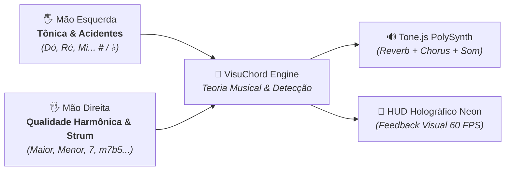

# 🎵 VisuChord — Instrumento Musical por Visão Computacional & Gestos


**VisuChord** é uma aplicação web interativa que transforma a webcam do computador em um instrumento musical polifônico e gestual, utilizando **Visão Computacional em tempo real (Google MediaPipe Hands)** acelerada por WebGL/Wasm na GPU do navegador e síntese sonora rica com **Tone.js**.

---

## 🎹 Como Funciona a Mecânica Musical

O sistema opera com um modelo de **Coordenação Bimanual Harmônica**:



### 1. Mão Esquerda: Tônica & Modulação Cromática
Permite selecionar **qualquer uma das 12 notas cromáticas ocidentais**:
* **Contagem de Dedos (Notas Naturais):**
  * ☝️ **1 dedo:** Dó (C)
  * ✌️ **2 dedos:** Ré (D)
  * 🤟 **3 dedos:** Mi (E)
  * 🖖 **4 dedos:** Fá (F)
  * 🖐️ **5 dedos:** Sol (G)
  * 🤙 **Hang Loose (Polegar + Mínimo):** Lá (A)
  * ✊ **Punho Fechado:** Si (B)
* **Modulador de Altura Espacial (Acidentes # / ♭):**
  * ▲ **Zona Superior da Tela:** Sustenido (`#`) — ex: *Fá#*, *Dó#*, *Sol#*
  * ◼ **Zona Central da Tela:** Nota Natural — ex: *Dó*, *Sol*, *Lá*
  * ▼ **Zona Inferior da Tela:** Bemol (`♭`) — ex: *Si♭*, *Mi♭*, *Lá♭*

---

### 2. Mão Direita: Qualidade do Acorde ("O Jeito") & Palhetada
Modula o tipo de tétrade ou tríade executada:
* 🖐️ **Mão Totalmente Aberta (5 dedos):** Acorde Maior (*ex: C, G, D*)
* ✌️ **2 Dedos (Paz & Amor):** Acorde Menor (*ex: Cm, Am, Em*)
* ☝️ **1 Dedo (Indicador):** Acorde Dominante com 7ª (*ex: G7, C7, E7*)
* 🤟 **4 Dedos:** Acorde Maior com Sétima Maior (*ex: C7M, F7M*)
* 👌 **Pinch (Polegar + Indicador se tocando):** Acorde Meio-Diminuto (*ex: Bm7b5, F#m7b5*)
* ✊ **Punho Fechado:** Acorde Diminuto Completo (*ex: C°*)

#### ⚡ O Gatilho (Palhetada no Ar / Strumming):
Ao fazer um movimento rápido de **descida no ar com a mão direita**, o motor de áudio calcula as notas exatas e as toca em cascata (*strumming* de 35ms), simulando o dedilhado de um violão ou harpa com efeito visual de onda de choque no canvas.

---

## 🛠️ Tecnologias & Engenharia

* **React 19 + Vite 8:** Arquitetura Single Page Application (SPA) para máxima performance gráfica com taxa de atualização de 60 frames por segundo.
* **Google MediaPipe Tasks Vision:** Detecção tridimensional de 21 marcos anatômicos (landmarks) das articulações da mão via WebAssembly e aceleração de GPU.
* **Tone.js:** Síntese sonora polifônica baseada na Web Audio API com envelope ADSR modelado, Reverb espacial e Chorus analógico.
* **Teclado Virtual Interativo:** Renderização de um piano polifônico no rodapé que acende dinamicamente em neon as teclas que compõem o acorde tocado.
* **Tailwind CSS v4:** Interface no estilo Sci-Fi / Cyberpunk com suporte a múltiplos timbres sonoros (*Warm Pad*, *Piano Elétrico*, *Violão*, *Synth Lead*).

---

## 🚀 Como Executar Localmente

```bash
# 1. Clonar o repositório
git clone https://github.com/FelipeGardenghiDev/visuchord.git
cd visuchord

# 2. Instalar dependências
pnpm install

# 3. Rodar o servidor de desenvolvimento
pnpm dev
# Acesse http://localhost:5173 e permita o acesso à webcam
```

---

## 👨‍💻 Autor

Desenvolvido por **Felipe Gardenghi Gonçalves**  
Sertãozinho, SP — Brasil

* **GitHub:** [github.com/FelipeGardenghiDev](https://github.com/FelipeGardenghiDev)
* **LinkedIn:** [linkedin.com/in/felipegardenghi](https://www.linkedin.com/in/felipegardenghi/)
* **Portfólio:** [felipegardenghi.dev](https://felipegardenghi.dev)
