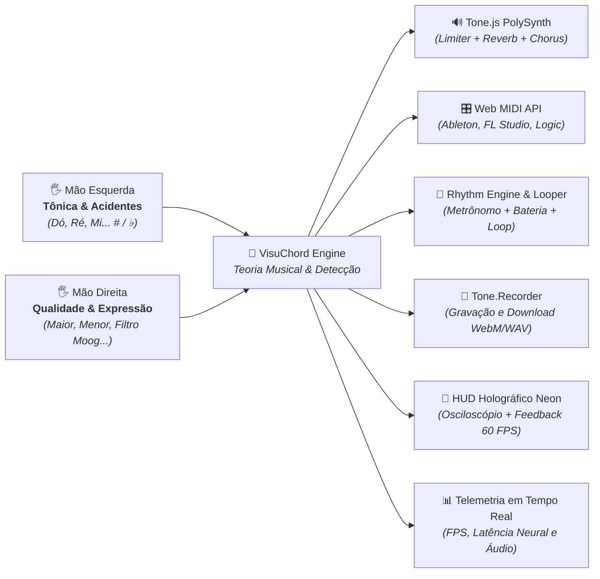

# 🎵 VisuChord — Instrumento Musical por Visão Computacional & Gestos

[](https://github.com/felipegardenghidev/visuchord/actions)
-brightgreen?style=flat-square)


**VisuChord** é uma aplicação web de ponta em nível de engenharia Staff/Principal que transforma a webcam do computador em um instrumento musical polifônico e **controlador MIDI sem fio para DAWs profissionais**, utilizando **Visão Computacional em tempo real (Google MediaPipe Hands)** acelerada por WebGL/Wasm na GPU do navegador e síntese sonora rica com **Tone.js**.

---

## 🏛️ Arquitetura & Decisões Formais (ADRs)

A engenharia do VisuChord é formalmente documentada em [`docs/ARCHITECTURE.md`](docs/ARCHITECTURE.md) através de 9 Architecture Decision Records:

1. **ADR-001:** Adoção de Google MediaPipe Hands Tasks-Vision (Wasm/GPU) em detrimento de TensorFlow.js/COCO-SSD.
2. **ADR-002:** Arquitetura de Coordenação Bimanual Harmônica desacoplada (Mão Esquerda = Tônica Cromática; Mão Direita = Qualidade/Modo Harmônico).
3. **ADR-003:** Estabilização Temporal e Anti-Jitter via Janela Deslizante de Votação Majoritária (Temporal Majority Voting).
4. **ADR-004:** Grafo de Áudio com Brickwall Limiter (-1 dBFS), Filtro Moog e Gravação Estéreo via `Tone.Recorder`.
5. **ADR-005:** Estratégia de Testes Unitários Cinemáticos Isolados de Hardware e Aceleração de CI.
6. **ADR-006:** Integração com Web MIDI API para controle direto de DAWs (Ableton, FL Studio, Logic, Reaper) via Note On/Off e CC 74.
7. **ADR-007:** Modulação Expressiva Contínua com Filtro Passa-Baixas Moog e Osciloscópio de Som FFT em tempo real.
8. **ADR-008:** Motor Rítmico com Metrônomo, Bateria Eletrônica e Looper de Progressões de Acordes (4 compassos).
9. **ADR-009:** Estratégia de Chunk Splitting no Vite para carregamento paralelo e bundle principal sub-70 kB.

---

## 🎹 Como Funciona a Mecânica Musical

O sistema opera com um modelo de **Coordenação Bimanual Harmônica**:



### 1. Mão Esquerda: Tônica & Modulação Cromática
Permite selecionar **qualquer uma das 12 notas cromáticas ocidentais**:
* **Contagem de Dedos (Notas Naturais):**
  * ☝️ **1 dedo:** Dó (C)
  * ✌️ **2 dedos:** Ré (D)
  * 🤟 **3 dedos:** Mi (E)
  * 🖖 **4 dedos:** Fá (F)
  * 🖐️ **5 dedos:** Sol (G)
  * 🤙 **Hang Loose (Polegar + Mínimo):** Lá (A)
  * ✊ **Punho Fechado:** Si (B)
* **Modulador de Altura Espacial (Acidentes # / ♭):**
  * ▲ **Zona Superior da Tela:** Sustenido (`#`) — ex: *Fá#*, *Dó#*, *Sol#*
  * ◼ **Zona Central da Tela:** Nota Natural — ex: *Dó*, *Sol*, *Lá*
  * ▼ **Zona Inferior da Tela:** Bemol (`♭`) — ex: *Si♭*, *Mi♭*, *Lá♭*

---

### 2. Mão Direita: Qualidade do Acorde, Expressão no Ar & Palhetada
* 🖐️ **Mão Aberta (5 dedos):** Acorde Maior (*ex: C, G, D*)
* ✌️ **2 Dedos:** Acorde Menor (*ex: Cm, Am, Em*)
* ☝️ **1 Dedo:** Acorde Dominante com 7ª (*ex: G7, C7, E7*)
* 🤟 **4 Dedos:** Acorde Maior com 7M (*ex: C7M, F7M*)
* 👌 **Pinch (Polegar + Indicador):** Acorde Meio-Diminuto (*ex: Bm7b5*)
* ✊ **Punho Fechado:** Acorde Diminuto Completo (*ex: C°*)
* 🎚️ **Modulação Theremin / Filtro Moog:** Elevar ou abaixar a mão direita modula continuamente o *Filter Cutoff* (250 Hz a 14 kHz) e despacha MIDI CC 74 em tempo real.

> 💡 **Customização Total de Gestos:** Todas as posições de mão para as notas e qualidades harmônicas podem ser livremente remapeadas no botão **Mapear** da barra de controles e são salvas automaticamente no navegador.

#### ⚡ O Gatilho (Palhetada no Ar / Strumming):
Ao fazer um movimento rápido de **descida no ar com a mão direita**, o motor de áudio calcula as notas exatas e as toca em cascata (*strumming* de 35ms), simulando o dedilhado de um violão ou harpa com efeito visual de onda de choque no canvas.

---

## ⚡ Recursos de Engenharia Staff / Principal

1. **🎛️ Controlador MIDI sem fio (Web MIDI API):**
   - Transmissão instantânea de pacotes `Note On` / `Note Off` e mensagens contínuas de `Control Change` (CC 74 para brilho/filtro).
   - Integração plug-and-play com DAWs profissionais (Ableton Live, FL Studio, Logic Pro, Reaper) e sintetizadores VST.

2. **🌊 Osciloscópio de Som FFT em Tempo Real:**
   - Analisador de forma de onda acoplado ao volume master renderizando um osciloscópio neon holográfico dinâmico na base do HUD.

3. **🥁 Motor Rítmico, Metrônomo & Looper de 4 Compassos:**
   - Síntese percussiva dedicada com bumbo e caixa via `Tone.MembraneSynth` e `Tone.NoiseSynth`.
   - Modos de Metrônomo, Lo-Fi Beat e Pulse com seletor de BPM (60 a 180).
   - Looper harmônico para gravar progressões de acordes no ar e deixá-las ciclando continuamente.

4. **🔴 Gravador de Áudio & Exportador Integrado (`Tone.Recorder`):**
   - Captura direta do fluxo estéreo na saída do limitador.
   - Timer visual ao vivo no HUD (`REC 00:00`) com pulso luminoso e download em WebM/WAV.

5. **📊 Telemetria em Tempo Real & Performance Monitor:**
   - Taxa de quadros gráfica em janela deslizante (alvo: **60 FPS** com semáforo visual).
   - Latência de Inferência da IA em milissegundos via `performance.now()`.
   - Latência de saída de buffer da Web Audio API (`baseLatency` + `outputLatency`).
   - Ciclo de renderização otimizado a cada 400ms para evitar *re-render thrashing*.

6. **🛡️ Resiliência de Hardware & Fallback com Playground Virtual:**
   - Captura e tratamento granular de exceções WebRTC (`NotAllowedError`, `NotFoundError`, `NotReadableError`).
   - Playground Virtual com esqueleto cinemático animado vetorialmente, permitindo tocar sem câmera física via teclado numérico (`1-7`), acidentes (`Z, X, C`), qualidades (`Q-U`) e barra de espaço.

7. **⚡ Otimização Extrema de Bundle (Vite Chunk Splitting):**
   - Particionamento em chunks isolados (`vendor-tone`, `vendor-mediapipe`, `vendor-react`, `vendor-icons`).
   - Bundle principal do VisuChord com apenas **69.2 kB**.

---

## 🛠️ Tecnologias & Engenharia

* **React 19 + Vite 8:** Arquitetura Single Page Application (SPA) para máxima performance gráfica com taxa de atualização de 60 frames por segundo.
* **Google MediaPipe Tasks Vision:** Detecção tridimensional de 21 marcos anatômicos (landmarks) das articulações da mão via WebAssembly e aceleração de GPU.
* **Tone.js & Web Audio API:** Grafo de áudio polifônico com limitador brickwall, filtro passa-baixas Moog, chorus, reverb, analisador de ondas e gravador estéreo.
* **Web MIDI API:** Comunicação MIDI de baixa latência diretamente com instrumentos virtuais e estações de áudio no computador.
* **Vitest 5.0.5:** Suíte com **55 testes unitários ultrarrápidos** (100% passando em ~450ms).
* **Tailwind CSS v4:** Interface Sci-Fi / Cyberpunk com suporte a múltiplos timbres sonoros (*Warm Pad*, *Piano Elétrico*, *Violão*, *Synth Lead*).

---

## 🚀 Como Executar Localmente

```bash
# 1. Clonar o repositório
git clone https://github.com/FelipeGardenghiDev/visuchord.git
cd visuchord

# 2. Instalar dependências
pnpm install

# 3. Rodar a suíte de testes automatizados (Vitest)
pnpm test

# 4. Rodar o servidor de desenvolvimento
pnpm dev
# Acesse http://localhost:5173
```

---

## 👨‍💻 Autor

Desenvolvido por **Felipe Gardenghi Gonçalves**  
Sertãozinho, SP — Brasil

* **GitHub:** [github.com/FelipeGardenghiDev](https://github.com/FelipeGardenghiDev)
* **LinkedIn:** [linkedin.com/in/felipegardenghi](https://www.linkedin.com/in/felipegardenghi/)
* **Portfólio:** [felipegardenghi.dev](https://felipegardenghi.dev)
